<p align="center">
   whoami. Aaron Cahill, Information Security Operations Lead at efex. PS> Get-Motto. Trust, but log everything.">
</p>

I got into security sideways. Started out in tech projects, kept pulling on whatever I was
curious about, and a homelab gave me somewhere to actually break things and figure out how
they work. Eventually that curiosity turned into starting the **InfoSec Ops team at efex**.

Most days it's Entra, Intune, Defender and Sentinel, and a lot of PowerShell so the boring
bits run themselves and people get to do the thinking. The big one so far has been
**ISO 27001**: taking our technical controls from all over the shop to something that
actually holds up.

### What I work with

<p align="center">
  
</p>

### Currently

```console
PS> Get-Current

Learning   : Python, one script at a time
Tinkering  : the homelab, as always
Theming    : my terminal, more neon than it needs to be
```
